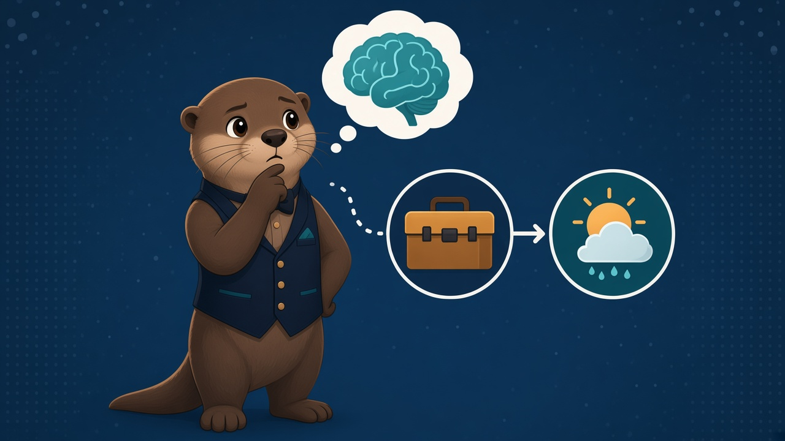

import CycleDiagram from '../../../../components/CycleDiagram.astro';
import UnitProgress from '../../../../components/UnitProgress.astro';

<UnitProgress done={3} />

Дотук научихме две неща:

- **Agent е система, която може да разсъждава (reason), да планира и да взаимодейства със средата си.**
- **Tools се предоставят на модела като текстово описание в system prompt-а.**

В тази секция ще ги съберем в едно и ще разгледаме **пълния работен процес на един Agent**: цикъла Thought-Action-Observation. В следващите три секции ще минем през всяка стъпка поотделно.

## Трите стъпки

Работата на един Agent се състои от три стъпки, които се повтарят:

| Стъпка | Кой я прави | Какво се случва |
| --- | --- | --- |
| **Thought** (мисъл) | Моделът | Обмисля ситуацията и решава каква да бъде следващата стъпка. |
| **Action** (действие) | Моделът и кодът на Agent-а | Моделът написва кой tool иска и с какви аргументи, а кодът го изпълнява. |
| **Observation** (наблюдение) | Кодът на Agent-а | Връща резултата от tool-а на модела. |

<CycleDiagram />

## Цикълът като код

Трите стъпки се повтарят, докато задачата не бъде решена. За програмист това е добре познато: **`while` цикъл**. Ето го като пример на C#:

```csharp
while (true)
{
    string output = AskModel(messages);

    if (IsFinalAnswer(output))
    {
        break;
    }

    string observation = RunTool(output);
    messages.Add(observation);
}
```

Това е само пример, а не програма за изпълнение: методите `AskModel`, `IsFinalAnswer` и `RunTool` още не съществуват. Ще ги напишем наистина в [Dummy Agent Library](/ai-agents/unit-1/dummy-agent-library/). Засега е важно само кой ред на коя стъпка отговаря:

| Ред от скицата | Стъпка |
| --- | --- |
| `AskModel(messages)` | **Thought:** моделът чете целия разговор и решава какво следва. |
| `RunTool(output)` | **Action:** кодът изпълнява tool-а, който моделът е поискал. |
| `messages.Add(observation)` | **Observation:** резултатът се добавя към разговора за следващата обиколка. |
| `IsFinalAnswer(output)` | Край: моделът е готов с отговора и цикълът спира. |

## Правилата са в system prompt-а

Откъде моделът знае, че трябва да работи така? От system prompt-а. Освен описанието на инструменти (tools), там записваме и правилата на цикъла:

```text wrap
You are an AI assistant designed to help users efficiently and accurately.
Your primary goal is to provide helpful, precise, and clear responses.

You have access to the following tools:
Tool Name: GetWeather, Description: Get the current weather in a given location., Arguments: location: string, Outputs: string

You should think step by step in order to fulfill the objective with a reasoning divided into Thought/Action/Observation steps that can repeat multiple times if needed.

You should first reflect on the current situation using `Thought: {your_thoughts}`, then (if necessary) call a tool with the proper JSON formatting `Action: {JSON_BLOB}`, or print your final answer starting with the prefix `Final Answer:`.
```

В този system prompt има три части:

- **Поведението на Agent-а** (първите два реда).
- **Tools, до които той има достъп**, описани както в предишната секция.
- **Правилата на цикъла** (последните два абзаца): първо `Thought`, после `Action` или `Final Answer`.

## Alfred, weather Agent-ът

Да проследим цикъла с пример. Alfred е Agent с един tool: `GetWeather`. Потребител го пита: „Какво е времето в Ню Йорк в момента?“


### 1. Thought

Моделът първо разсъждава какво му трябва:

*„Потребителят иска актуална информация за времето в Ню Йорк. Имам tool, който извлича данни за времето. Първо трябва да го извикам.“*



### 2. Action

Моделът знае за `GetWeather` от system prompt-а и написва извикването му във формата, който сме му задали:

```text
Thought: I need to check the current weather for New York.
Action: {"action": "GetWeather", "action_input": {"location": "New York"}}
```

Един Action казва две неща: **кой tool** да бъде извикан и **с какви аргументи**. Моделът само го написва. Самото извикване прави кодът на Agent-а.


### 3. Observation

Кодът на Agent-а изпълнява `GetWeather` и добавя резултата към разговора:

```text
Observation: Current weather in New York: partly cloudy, 15°C, 60% humidity.
```

Този ред не е написан от модела. Той е обратната връзка от реалния свят: показва дали action-ът е успял и какви са данните.


### 4. Нов Thought

Моделът прочита разговора отново, вече с новия Observation, и преценява ситуацията:

*„Вече имам данните за времето в Ню Йорк. Мога да отговоря на потребителя.“*


### 5. Финален отговор

Моделът написва отговора във формата, който сме му задали, и цикълът приключва:

```text wrap
Thought: I have the weather data now.
Final Answer: The current weather in New York is partly cloudy with a temperature of 15°C and 60% humidity.
```


## Какво показва примерът

- **Agents работят в цикъл, докато целта не бъде постигната.** Ако Observation беше грешка или непълни данни, Alfred щеше да направи още една обиколка и да опита нещо друго.
- **Tools дават достъп до света извън модела.** Без `GetWeather` Alfred можеше само да гадае какво е времето.
- **Всяка обиколка добавя нова информация.** Observation става част от разговора, затова следващият Thought стъпва върху реални данни.

Това редуване на мислене и действие се нарича *ReAct* и ще го разгледаме в следващата секция.

---

Сега да минем по-подробно през Thought, Action и Observation като отделни стъпки от процеса.
