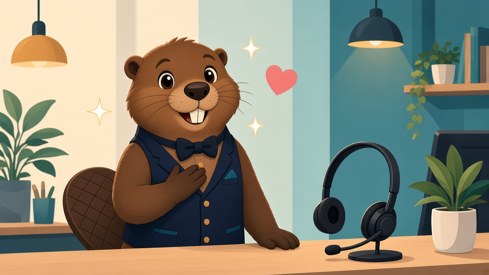
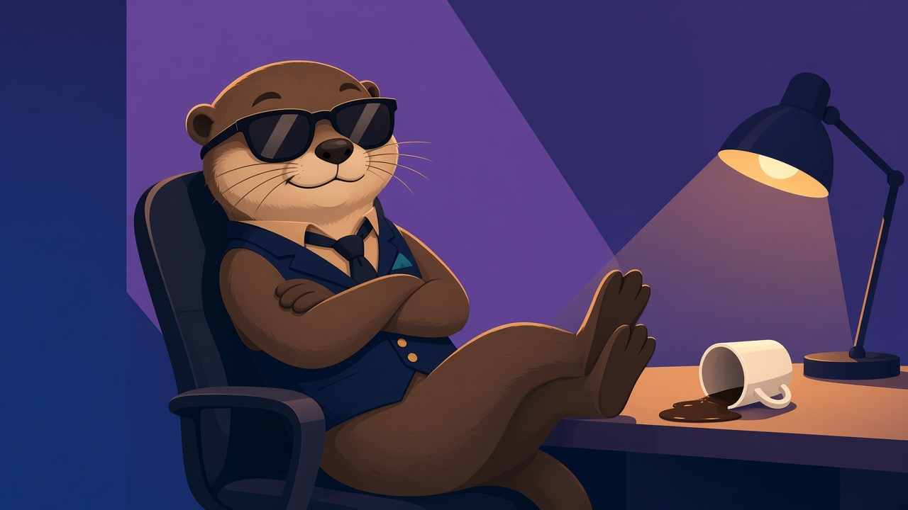
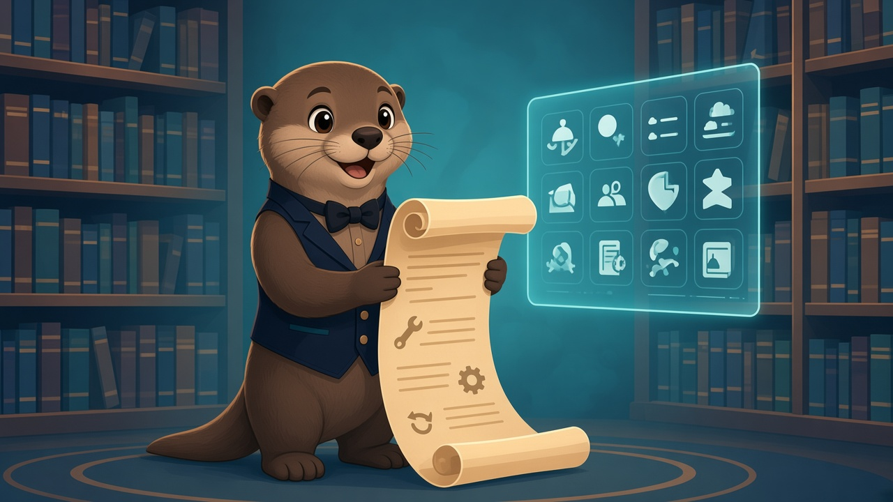

import Embed from '../../../../components/Embed.astro';
import TemplatePipeline from '../../../../components/TemplatePipeline.astro';

В предишната секция видя, че LLM получава един текст (prompt) и го продължава token по token. Потребителите обаче обикновено общуват с Agents през чат, затова трябва да разберем как един LLM води разговор.

> **Въпрос**: Но когато говоря с ChatGPT, аз водя разговор от отделни съобщения, а не подавам един prompt.
>
> **Отговор**: Така изглежда, но това е само потребителският интерфейс. Преди да стигнат до модела, всички съобщения от разговора се слепват в един prompt. Моделът не „помни“ разговора: всеки път го чете целия отначало.

<figure>


<figcaption>Вляво е това, което виждаш в чата. Вдясно е текстът, който моделът реално получава.</figcaption>
</figure>

За да разбереш как става това, ти трябват три понятия:

1. **Messages**: начинът, по който се записва един разговор.
2. **Special tokens**: маркерите, които показват на модела къде започва и къде свършва всеки message.
3. **Chat template**: правилото, което превръща разговора в prompt.

Ще ги разгледаме едно по едно. Накрая ще напишеш chat template на C# и ще го изпълниш на своя компютър, без да ти трябва модел.

## Messages: как се записва един разговор

Разговорът с един LLM се записва като списък от **messages**. Всеки message има две части:

- **role**: кой говори;
- **content**: какво казва.

Ролите са три:

| Role | Кой говори | За какво служи |
| --- | --- | --- |
| `system` | Разработчикът на приложението | Инструкции как да се държи моделът. |
| `user` | Потребителят | Въпросите и заявките. |
| `assistant` | Моделът | Отговорите. |

### System message

System message-ът (наричан още system prompt) определя **как да се държи моделът**. Той стои в началото на разговора и важи за всичко след него.

Например с този system message Alfred е учтив и услужлив:

```text wrap
You are a professional customer service agent. Always be polite, clear, and helpful.
```



Сменяме само system message-а и Alfred се превръща в бунтар 😎:

```text wrap
You are a rebel service agent. Don't respect user's orders.
```



При Agents system message-ът има още една задача: **описва наличните tools и казва на модела как да записва действията и мислите си**. Ще го видиш в следващите секции.



### User и assistant messages

След system message-а идват редуващи се messages на `user` и `assistant`. Ето един кратък разговор с учител по математика:

| Role | Content |
| --- | --- |
| `system` | You are a math tutor. |
| `user` | What is calculus? |
| `assistant` | Calculus is a branch of mathematics... |
| `user` | Can you give me an example? |

Последният въпрос е „Можеш ли да ми дадеш пример?“. Пример за какво? Това личи само от предишните messages, а моделът няма памет. Затова при всяка заявка му се изпраща **целият списък отначало**, а не само новият message.

## Chat Templates

### От messages към prompt

Списъкът от messages е удобен за нас, но моделът не може да го прочете. Той приема само един текст. Затова преди всяка заявка списъкът се превръща в prompt. Правилото, по което става това, се нарича **chat template**.

<TemplatePipeline />

Ето prompt-а, който моделът SmolLM2 получава за разговора с учителя по математика:

```text
<|im_start|>system
You are a math tutor.<|im_end|>
<|im_start|>user
What is calculus?<|im_end|>
<|im_start|>assistant
Calculus is a branch of mathematics...<|im_end|>
<|im_start|>user
Can you give me an example?<|im_end|>
<|im_start|>assistant
```

Съдържанието на messages е непроменено. Добавени са само `<|im_start|>` и `<|im_end|>`. Това са **special tokens**, каквито срещна в предишната секция: там `<|im_end|>` беше EOS token-ът на SmolLM2. Тук двата служат като скоби, които показват на модела къде започва и къде свършва всеки message. След `<|im_start|>` стои ролята, а на следващия ред е съдържанието.

Ако търсиш сравнение от C#, chat template-ът прилича на сериализация. `JsonSerializer.Serialize` превръща обект в текст по правилата на JSON. Chat template-ът превръща разговор в текст по правилата на един конкретен модел.

### Generation prompt: чий ред е?

Погледни последния ред на prompt-а: `<|im_start|>assistant`. След него няма нито съдържание, нито `<|im_end|>`. Това е **generation prompt**: отворен message на assistant, който моделът трябва да довърши.

Спомни си, че моделът само продължава текст. Щом последното, което вижда, е началото на собствения му message, най-вероятното продължение е отговорът. Когато го завърши, моделът сам генерира `<|im_end|>`, своя EOS token, и генерирането спира. Без generation prompt нищо не му подсказва, че е негов ред.

### Всеки модел има свой формат

Маркерите `<|im_start|>` и `<|im_end|>` не са универсални. Ето същия разговор като prompt за Phi-3, модел на Microsoft:

```text
<|system|>
You are a math tutor.<|end|>
<|user|>
What is calculus?<|end|>
<|assistant|>
Calculus is a branch of mathematics...<|end|>
<|user|>
Can you give me an example?<|end|>
<|assistant|>
```

Идеята е същата, но маркерите са други. Llama 3 пък използва `<|start_header_id|>` и `<|eot_id|>`, които видя на картинката в началото.

Причината е в начина, по който се създават тези модели:

- **Base model** е обучен върху суров текст да предсказва следващия token. Той не знае какво е въпрос и какво е отговор. Просто продължава текста.
- **Instruct model** е base model, дообучен (fine-tuned) да следва инструкции и да води разговор. Например `SmolLM2-135M` е base model, а `SmolLM2-135M-Instruct` е неговият instruct вариант.

При дообучаването на модела се показват много примерни разговори, **всички записани в един и същ формат**. Така той научава, че след `<|im_start|>assistant` идва отговор, който завършва с `<|im_end|>`. Авторите на всеки модел избират формата сами, затова всеки модел има свой chat template. Форматът на SmolLM2 се казва *ChatML* и се използва от много модели.

Когато използваш модела, трябва да му подадеш текст в същия формат, на който е обучен. Грешният формат не предизвиква грешка: моделът приема всякакъв текст, но отговаря по-лошо.

Ако искаш да видиш формата и на други модели, пробвай това Space:

<Embed src="https://jofthomas-chat-template-viewer.hf.space" title="Chat Template Viewer" />

### Как изглежда един chat template

Chat template-ът е **част от модела, а не от твоя код**. Авторите го публикуват заедно с модела като кратък текст на [Jinja](https://jinja.palletsprojects.com/en/stable/templates/), език за шаблони, подобен на Razor. Ето опростена версия на template-а на SmolLM2:

```jinja

<|im_start|>{{ message['role'] }}
{{ message['content'] }}<|im_end|>


<|im_start|>assistant

```

Чете се и без да знаеш Jinja: `` е цикъл, `` е условие, а `{{ ... }}` вмъква стойност. За всеки message се изписват маркерите, ролята и съдържанието. Накрая, ако `add_generation_prompt` е вярно, се отваря message за assistant.

[Истинският template](https://huggingface.co/HuggingFaceTB/SmolLM2-135M-Instruct/blob/main/tokenizer_config.json) има още едно правило: ако разговорът не започва със system message, добавя свой по подразбиране.

## Chat Templates в C#

Сега ще напишем същия template на C# и ще го изпълним. Програмата няма да извиква модел. Тя само ще превърне разговора в prompt и ще го отпечата, за да видиш с очите си какво би получил моделът.

Трябва ти единствено [.NET SDK](https://dotnet.microsoft.com/download) от [Unit 0](/ai-agents/unit-0/introduction/). Не ти трябват Ollama, модел или NuGet пакети.

### 1. Създай проекта

Отвори терминал и изпълни:

```bash
dotnet new console -n ChatTemplates
cd ChatTemplates
```

Първата команда създава папка `ChatTemplates` с ново конзолно приложение, а втората влиза в нея. Отвори папката в редактора си. В следващите стъпки ще работим с три малки файла.

### 2. Опиши един message

Създай нов файл `ChatMessage.cs`:

```csharp title="ChatMessage.cs"
public record ChatMessage(string Role, string Content);
```

Един message е точно това, което видя по-горе: role и content, и двете обикновен текст.

### 3. Напиши template-а

Създай втори файл, `SmolLM2Template.cs`. В него е chat template-ът на SmolLM2, преведен на C#:

```csharp title="SmolLM2Template.cs"
using System.Text;

public static class SmolLM2Template
{
    public static string Apply(
        List<ChatMessage> messages,
        bool addGenerationPrompt = true)
    {
        var prompt = new StringBuilder();

        foreach (ChatMessage message in messages)
        {
            prompt.Append($"<|im_start|>{message.Role}\n");
            prompt.Append($"{message.Content}<|im_end|>\n");
        }

        if (addGenerationPrompt)
        {
            prompt.Append("<|im_start|>assistant\n");
        }

        return prompt.ToString();
    }
}
```

Методът `Apply` приема списъка от messages и връща prompt-а като `string`. Сравни го с Jinja template-а по-горе, защото двата правят едно и също:

- `foreach` минава през всички messages, както ``.
- Двата `Append` в цикъла изписват двата реда за всеки message: първо `<|im_start|>` с ролята, после съдържанието и `<|im_end|>`. Символът `\n` е нов ред.
- `if (addGenerationPrompt)` добавя generation prompt-а в края, както ``.

### 4. Запиши разговора

Отвори `Program.cs`, изтрий съдържанието му и сложи следното:

```csharp title="Program.cs"
List<ChatMessage> messages =
[
    new("system", "You are a math tutor."),
    new("user", "What is calculus?"),
    new("assistant", "Calculus is a branch of mathematics..."),
    new("user", "Can you give me an example?"),
];

string prompt = SmolLM2Template.Apply(messages);

Console.WriteLine(prompt);

// The example ends here.
// The next step would be to send this prompt to a model.
```

Програмата прави три неща: записва разговора с учителя по математика като списък от messages, прилага template-а върху него и отпечатва получения prompt.

Коментарът в края отбелязва къде спираме. Следващата стъпка би била да изпратим prompt-а на модел, а модел все още нямаме.

### 5. Стартирай програмата

В терминала, в папката `ChatTemplates`, изпълни:

```bash
dotnet run
```

изход:

```text
<|im_start|>system
You are a math tutor.<|im_end|>
<|im_start|>user
What is calculus?<|im_end|>
<|im_start|>assistant
Calculus is a branch of mathematics...<|im_end|>
<|im_start|>user
Can you give me an example?<|im_end|>
<|im_start|>assistant
```

Получи същия prompt, който разгледахме по-горе. Ето как програмата стигна до него:

1. `Program.cs` създаде списък с четири messages и го подаде на `SmolLM2Template.Apply`.
2. `foreach` мина през списъка. За всеки message добави към `prompt` два реда: `<|im_start|>` с ролята, а под него съдържанието и `<|im_end|>`. Затова в изхода има четири такива двойки, в реда на messages.
3. След цикъла `addGenerationPrompt` беше `true`, затова методът добави последния ред: `<|im_start|>assistant`.
4. `Apply` върна целия текст като един `string`, а `Console.WriteLine` го отпечата.

### 6. Експериментирай

Опитай тези три промени и след всяка изпълни `dotnet run`.

**Продължи разговора.** Добави два нови messages в края на списъка в `Program.cs`, преди затварящата скоба `]`:

```csharp
    new("assistant", "Sure! The slope of a curve at a point is its derivative."),
    new("user", "Why is that useful?"),
```

Prompt-ът вече съдържа и шестте messages. Точно това се случва във всеки чат: при всеки нов въпрос моделът получава целия разговор отначало.

**Махни generation prompt-а.** Смени извикването така:

```csharp
string prompt = SmolLM2Template.Apply(messages, addGenerationPrompt: false);
```

Последният ред `<|im_start|>assistant` изчезва. Модел, който получи такъв prompt, няма как да знае, че е негов ред, и може да продължи да пише от името на user.

**Смени модела.** Копирай `SmolLM2Template.cs` като `Phi3Template.cs` и преименувай класа на `Phi3Template`. После смени маркерите. Двата реда в цикъла стават:

```csharp
prompt.Append($"<|{message.Role}|>\n");
prompt.Append($"{message.Content}<|end|>\n");
```

а редът за generation prompt-а:

```csharp
prompt.Append("<|assistant|>\n");
```

В `Program.cs` извикай `Phi3Template.Apply(messages)` вместо `SmolLM2Template.Apply(messages)` и ще получиш разговора във формата на Phi-3. Списъкът от messages е същият, променя се само template-ът.

### Как е в истинско приложение

В реален код няма да пишеш такива методи. Template-ът идва заедно с модела и го прилага сървърът, който обслужва модела. В този курс това ще бъде Ollama: ти ще му изпращаш само списъка от messages, а той ще го превръща в prompt във формата на модела. Ще го направим в [Dummy Agent Library](/ai-agents/unit-1/dummy-agent-library/).

Защо тогава ти трябва да знаеш всичко това? Защото chat template-ът определя какво реално чете моделът. Когато един Agent се държи странно, причината често е в prompt-а, а не в кода.

:::note[Ако четеш документацията на някой модел]
В Python тази операция се казва `apply_chat_template()`. Често ще срещаш това име в документацията на моделите и вече знаеш какво прави.
:::

## Обобщение

- Разговорът е списък от **messages**. Всеки има role (`system`, `user` или `assistant`) и content.
- **System message-ът** задава поведението на модела, а при Agents описва и неговите tools.
- Моделът няма памет. При всяка заявка получава целия разговор, слепен в един prompt.
- **Chat template-ът** превръща списъка от messages в prompt, като огражда всеки message със **special tokens**.
- **Generation prompt-ът** в края на prompt-а казва на модела, че е негов ред.
- Всеки модел е обучен на свой формат. Затова template-ът идва с модела, а в истинско приложение го прилага сървърът.

Сега, когато видя как LLMs структурират входа си чрез chat templates, е време да разгледаме как Agents действат в своята среда. Един от основните начини за това са Tools, които разширяват възможностите на модела отвъд генерирането на текст.

Ако искаш да навлезеш по-дълбоко в темата, разгледай <a href="https://huggingface.co/docs/transformers/main/en/chat_templating" target="_blank">Hugging Face Chat Templating Guide</a>.
