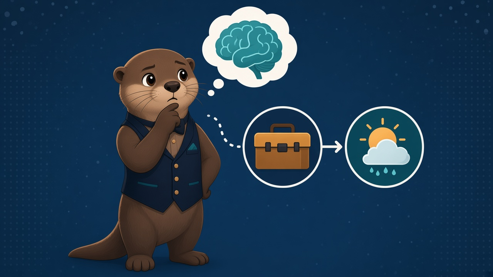
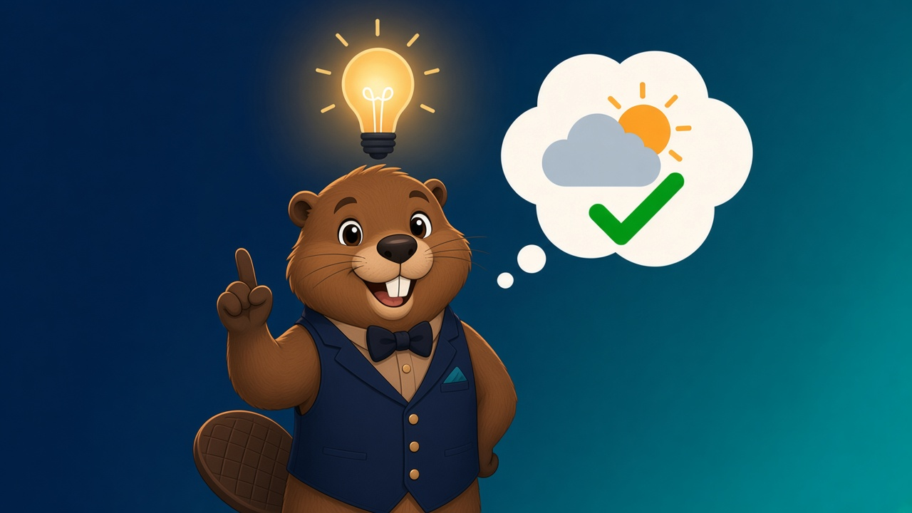
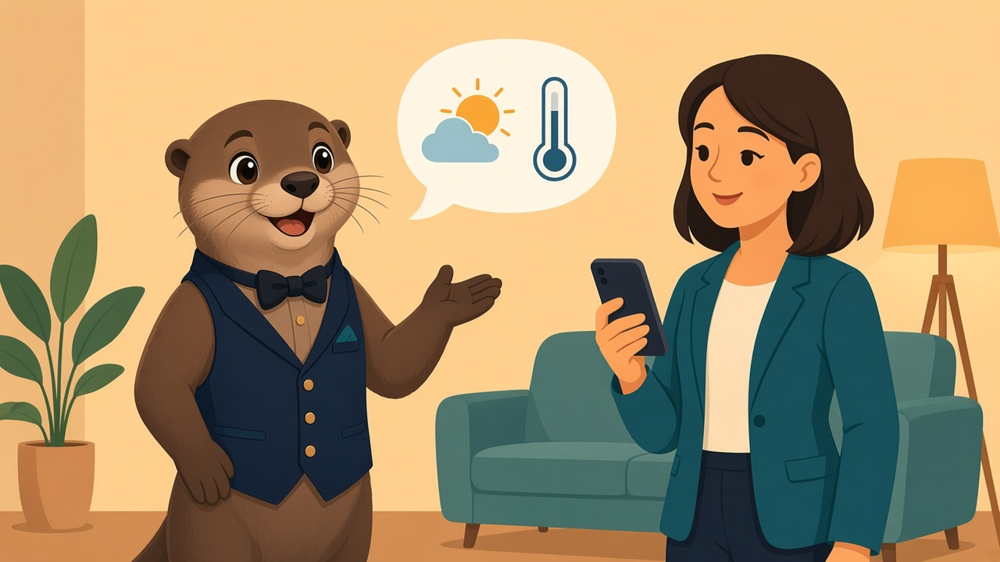

import CycleDiagram from '../../../../../components/CycleDiagram.astro';
import UnitProgress from '../../../../../components/UnitProgress.astro';

<UnitProgress done={3} />

So far we have learned two things:

- **An Agent is a system that can reason, plan and interact with its environment.**
- **Tools are given to the model as a text description in the system prompt.**

In this section we put them together and look at **the complete workflow of an Agent**: the Thought-Action-Observation cycle. The next three sections go through each step on its own.

## The three steps

The work of an Agent consists of three steps that repeat:

1. **Thought:** the LLM decides what the next step should be.
2. **Action:** the Agent calls a tool with the right arguments.
3. **Observation:** the tool's result goes back to the model, which reflects on it.

<CycleDiagram />

## The cycle as code

The three steps repeat until the task is solved. To a programmer that is a familiar thing: a **`while` loop**. Here it is as a C# sketch (this is not working code, only the idea):

```csharp
while (true)
{
    string reply = AskModel(messages);

    if (IsFinalAnswer(reply))
    {
        return reply;
    }

    string observation = RunTool(reply);
    messages.Add(observation);
}
```

| Line in the sketch | Step |
| --- | --- |
| `AskModel(messages)` | **Thought:** the model reads the whole conversation and decides what comes next. |
| `RunTool(reply)` | **Action:** our code runs the tool the model asked for. |
| `messages.Add(observation)` | **Observation:** the result is added to the conversation for the next round. |

## The rules live in the system prompt

How does the model know it should work this way? From the system prompt. Besides the tool descriptions, that is where we write the rules of the cycle itself:

```text wrap
You are an AI assistant designed to help users efficiently and accurately. Your primary goal is to provide helpful, precise, and clear responses.

You have access to the following tools:
Tool Name: GetWeather, Description: Get the current weather in a given location., Arguments: location: string, Outputs: string

You should think step by step in order to fulfill the objective with a reasoning divided into Thought/Action/Observation steps that can repeat multiple times if needed.

You should first reflect on the current situation using `Thought: {your_thoughts}`, then (if necessary) call a tool with the proper JSON formatting `Action: {JSON_BLOB}`, or print your final answer starting with the prefix `Final Answer:`.
```

This system prompt contains three things:

- **The Agent's behavior** (the first paragraph).
- **The tools it has access to**, described as in the previous section.
- **The Thought-Action-Observation cycle**, written as instructions to the model.

## Alfred, the weather Agent

Let's follow the cycle with an example. Alfred is an Agent with a single tool: `GetWeather`. A user asks him: "What's the weather like in New York right now?"


### 1. Thought

Alfred first reasons about what he needs:

*"The user wants current weather information for New York. I have a tool that fetches weather data. First, I need to call it."*



### 2. Action

Alfred knows about `GetWeather` from the system prompt, so he prepares a call in JSON format:

```text
Thought: I need to check the current weather for New York.
Action: {"action": "GetWeather", "action_input": {"location": "New York"}}
```

An Action says two things: **which tool** to call and **with what arguments**. The call itself is made by the Agent's code, not by the model.


### 3. Observation

The tool runs and returns a result:

```text
Observation: Current weather in New York: partly cloudy, 15°C, 60% humidity.
```

This text is added to the conversation. That is how the model gets feedback from the real world: whether the action succeeded and what the data is.


### 4. A new Thought

With this Observation, Alfred assesses the situation again:

*"I now have the weather data for New York. I can answer the user."*



### 5. Final answer

Alfred writes the answer in the format we told him to use, and the cycle ends:

```text wrap
Thought: I have the weather data now.
Final Answer: The current weather in New York is partly cloudy with a temperature of 15°C and 60% humidity.
```



## What the example shows

- **Agents work in a loop until the goal is reached.** If the Observation had been an error or incomplete data, Alfred would have gone around once more and tried something else.
- **Tools give access to the world outside the model.** Without `GetWeather`, Alfred could only guess what the weather is.
- **Every round adds new information.** The Observation becomes part of the conversation, so the next Thought builds on real data.

This alternation of thinking and acting is called *ReAct*, and we will look at it in the next section.

---

Now let's go through Thought, Action and Observation in more detail, as individual steps of the process.
