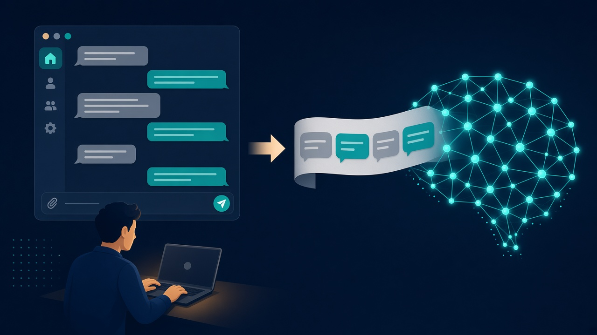
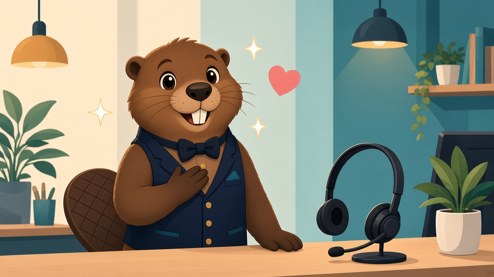
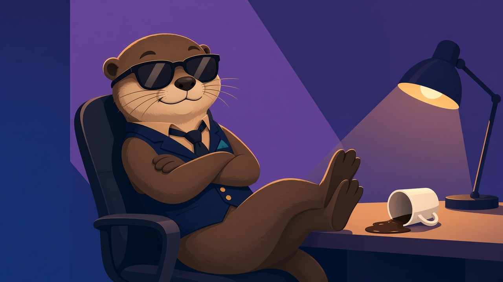
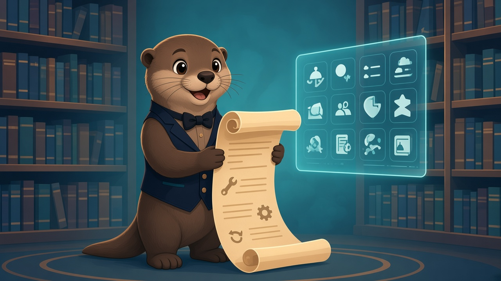

import Embed from '../../../../../components/Embed.astro';
import TemplatePipeline from '../../../../../components/TemplatePipeline.astro';

Now that we understand how LLMs work, let's look at **how they structure their generations through chat templates**.

Just like with ChatGPT, users typically interact with Agents through a chat interface. Therefore, we aim to understand how LLMs manage chats.

> **Q**: But ... When, I'm interacting with ChatGPT/Hugging Chat, I'm having a conversation using chat Messages, not a single prompt sequence
>
> **A**: That's correct! But this is in fact a UI abstraction. Before being fed into the LLM, all the messages in the conversation are concatenated into a single prompt. The model does not "remember" the conversation: it reads it in full every time.

Up until now, we've discussed prompts as the sequence of tokens fed into the model. But when you chat with systems like ChatGPT or HuggingChat, **you're actually exchanging messages**. Behind the scenes, these messages are **concatenated and formatted into a prompt that the model can understand**.

<figure>



<figcaption>We see here the difference between what we see in UI and the prompt fed to the model.</figcaption>
</figure>

This is where chat templates come in. They act as the **bridge between conversational messages (user and assistant turns) and the specific formatting requirements** of your chosen LLM. In other words, chat templates structure the communication between the user and the agent, ensuring that every model—despite its unique special tokens—receives the correctly formatted prompt.

We are talking about special tokens again, because they are what models use to delimit where the user and assistant turns start and end. Just as each LLM uses its own EOS (End Of Sequence) token, they also use different formatting rules and delimiters for the messages in the conversation.

## Messages: The Underlying System of LLMs

### System Messages

System messages (also called System Prompts) define **how the model should behave**. They serve as **persistent instructions**, guiding every subsequent interaction.

In .NET we'll use the `ChatMessage` type from the [`Microsoft.Extensions.AI`](https://learn.microsoft.com/dotnet/ai/microsoft-extensions-ai) library — it corresponds to the `{"role": ..., "content": ...}` dictionary you see in most APIs. For example:

```csharp
using Microsoft.Extensions.AI;

var systemMessage = new ChatMessage(
    ChatRole.System,
    "You are a professional customer service agent. Always be polite, clear, and helpful.");
```

With this System Message, Alfred becomes polite and helpful:



But if we change it to:

```csharp
var systemMessage = new ChatMessage(
    ChatRole.System,
    "You are a rebel service agent. Don't respect user's orders.");
```

Alfred will act as a rebel Agent 😎:



When using Agents, the System Message also **gives information about the available tools, provides instructions to the model on how to format the actions to take, and includes guidelines on how the thought process should be segmented.**



### Conversations: User and Assistant Messages

A conversation consists of alternating messages between a Human (user) and an LLM (assistant).

Chat templates help maintain context by preserving conversation history, storing previous exchanges between the user and the assistant. This leads to more coherent multi-turn conversations.

For example:

```csharp
List<ChatMessage> conversation =
[
    new(ChatRole.User, "I need help with my order"),
    new(ChatRole.Assistant, "I'd be happy to help. Could you provide your order number?"),
    new(ChatRole.User, "It's ORDER-123"),
];
```

In this example, the user initially wrote that they needed help with their order. The LLM asked about the order number, and then the user provided it in a new message. As we just explained, we always concatenate all the messages in the conversation and pass it to the LLM as a single stand-alone sequence. The chat template converts all the messages inside this C# list into a prompt, which is just a string input that contains all the messages.

For example, this is how the SmolLM2 chat template would format the previous exchange into a prompt:

```text
<|im_start|>system
You are a helpful AI assistant named SmolLM, trained by Hugging Face<|im_end|>
<|im_start|>user
I need help with my order<|im_end|>
<|im_start|>assistant
I'd be happy to help. Could you provide your order number?<|im_end|>
<|im_start|>user
It's ORDER-123<|im_end|>
<|im_start|>assistant
```

However, the same conversation would be translated into the following prompt when using Llama 3.2:

```text
<|begin_of_text|><|start_header_id|>system<|end_header_id|>

Cutting Knowledge Date: December 2023
Today Date: 10 Feb 2025

<|eot_id|><|start_header_id|>user<|end_header_id|>

I need help with my order<|eot_id|><|start_header_id|>assistant<|end_header_id|>

I'd be happy to help. Could you provide your order number?<|eot_id|><|start_header_id|>user<|end_header_id|>

It's ORDER-123<|eot_id|><|start_header_id|>assistant<|end_header_id|>
```

Templates can handle complex multi-turn conversations while maintaining context:

```csharp
List<ChatMessage> messages =
[
    new(ChatRole.System, "You are a math tutor."),
    new(ChatRole.User, "What is calculus?"),
    new(ChatRole.Assistant, "Calculus is a branch of mathematics..."),
    new(ChatRole.User, "Can you give me an example?"),
];
```

## Chat Templates

We now know *what* we send to the model: a list of messages with roles. What remains is *how* that list becomes the text the model actually reads. That is the job of the chat template.

### What is a chat template?

**A chat template is a template that ships with the model and turns the list of messages into one single string (the prompt), in exactly the format the model saw conversations in during training.**

Described as a C# signature, it is just a function:

```csharp
string ApplyChatTemplate(
    IReadOnlyList<ChatMessage> messages,
    bool addGenerationPrompt);
```

The closest analogy for a C# developer is serialization. `JsonSerializer.Serialize(order)` turns an object into text following the rules of JSON. A chat template turns a conversation into text following the rules of one specific model. The difference is that there is no shared standard like JSON here: every model has its own format, and that format is described in its chat template.

<TemplatePipeline />

Three things are worth remembering from the start:

1. **The template belongs to the model, not to your code.** The model's authors publish it together with the weights and the tokenizer.
2. **The result is a plain `string`.** There is no hidden state and no "session". There is only text in which special tokens mark where each message starts and ends.
3. **It is applied on every request, to the whole conversation.** The model appears to "remember" because it receives the full history again each time.

### Why they are needed: Base Models vs. Instruct Models

To see why the format matters so much, we need to tell two kinds of models apart:

- *A Base Model* is trained on raw text data to predict the next token. It has no notion of a "question" or an "answer". It simply continues the text.

- An *Instruct Model* is fine-tuned specifically to follow instructions and engage in conversations. For example, `SmolLM2-135M` is a base model, while `SmolLM2-135M-Instruct` is its instruction-tuned variant.

An instruct model is created by showing the base model many example conversations, **all formatted in exactly the same way**. That is how it learns the pattern: after the marker for the assistant's turn comes an answer, and the answer ends with an end-of-turn marker. When we later use the model, we have to give it text in that *same* format. Otherwise we ask it to continue text unlike anything it saw during training, and the quality of its answers drops.

*ChatML* is one such format, which structures conversations with clear role indicators (system, user, assistant). If you have worked with an AI API lately, the "list of messages with roles" structure is already familiar.

It's important to note that a base model could be fine-tuned on different chat templates, so when we're using an instruct model we need to make sure we're using the correct chat template.

### Anatomy of a prompt

Take the math tutor conversation from the end of the previous section. The chat template of `SmolLM2-135M-Instruct` turns it into this prompt:

```text
<|im_start|>system
You are a math tutor.<|im_end|>
<|im_start|>user
What is calculus?<|im_end|>
<|im_start|>assistant
Calculus is a branch of mathematics...<|im_end|>
<|im_start|>user
Can you give me an example?<|im_end|>
<|im_start|>assistant
```

Every turn in the conversation follows the same pattern:

| Part | In the example | What it means |
| --- | --- | --- |
| Start-of-turn marker | `<\|im_start\|>` | Special token: a new message starts here. |
| Role | `system`, `user`, `assistant` | Who is speaking. |
| Content | `What is calculus?` | The text of the message. |
| End-of-turn marker | `<\|im_end\|>` | Special token: the message is over. For SmolLM2 this is also the EOS token. |

Other models follow the same idea with different markers:

| Model | Start of a user turn | End of turn |
| --- | --- | --- |
| SmolLM2, Qwen2.5 (ChatML) | `<\|im_start\|>user` | `<\|im_end\|>` |
| Phi-3 | `<\|user\|>` | `<\|end\|>` |
| Llama 3.2 | `<\|start_header_id\|>user<\|end_header_id\|>` | `<\|eot_id\|>` |
| Gemma 2 | `<start_of_turn>user` | `<end_of_turn>` |
| Mistral 7B | `[INST]` | `[/INST]` |

These markers are not interchangeable. `<|im_start|>` is a special token for SmolLM2, but for Llama 3.2 it is just a sequence of ordinary characters with no special meaning.

### Generation prompt: whose turn is it?

Look at the last line of the prompt again: `<|im_start|>assistant`, with no content and no `<|im_end|>`. This is the **generation prompt**: an open assistant turn that the model has to complete.

Without it, the prompt ends with the closed user turn:

```text
<|im_start|>user
Can you give me an example?<|im_end|>
```

The model only continues text, and nothing tells it that it is its turn. It may answer, but it may also start a new user turn or write something else entirely.

With the generation prompt, the last thing the model sees is the start of its own turn:

```text
<|im_start|>user
Can you give me an example?<|im_end|>
<|im_start|>assistant
```

Now the most likely continuation is the answer itself. When the answer is complete, the model generates `<|im_end|>` on its own. That is its EOS token, and generation stops there.

Inside the template this behavior is controlled by the `add_generation_prompt` flag. When we want an answer from the model, it is `true`. The value `false` is mainly used when preparing fine-tuning data, where the conversation already contains the assistant's answer.

### Where does the template live?

The template travels with the model. You will find it in one of these places:

| Location | Description |
| --- | --- |
| A `chat_template.jinja` file in the model's repo on the Hub | A standalone text file. This is the recommended format today. Example: [`SmolLM3-3B`](https://huggingface.co/HuggingFaceTB/SmolLM3-3B/blob/main/chat_template.jinja). |
| The `chat_template` field in `tokenizer_config.json` | The whole template as one JSON string. An older format that is still very common. Example: [`SmolLM2-135M-Instruct`](https://huggingface.co/HuggingFaceTB/SmolLM2-135M-Instruct/blob/main/tokenizer_config.json). |
| The `tokenizer.chat_template` metadata key in a GGUF file | The template is embedded in the model file itself. Tools such as llama.cpp read it from there. |

In all three cases the content is the same: text written in [Jinja2](https://jinja.palletsprojects.com/en/stable/templates/). Jinja2 is a templating language from the Python world, but the template itself is plain text and **you don't need Python to use it**. If you have written Razor, Liquid or Scriban templates, the idea is familiar: text with embedded expressions and control structures.

### How to read a template

Here is the chat template of `SmolLM2-135M-Instruct`. In `tokenizer_config.json` it is stored as one long string. Here it is laid out on several indented lines, with line breaks shown as `\n`, to make it easier to read:

```jinja

    
        {{ '<|im_start|>system\nYou are a helpful AI assistant named SmolLM, trained by Hugging Face<|im_end|>\n' }}
    
    {{ '<|im_start|>' + message['role'] + '\n' + message['content'] + '<|im_end|>' + '\n' }}


    {{ '<|im_start|>assistant\n' }}

```

Jinja2 constructs map directly to C#:

| Jinja2 | What it does | In C# |
| --- | --- | --- |
| `` … `` | Loops over the messages. | `for (int i = 0; i < messages.Count; i++) { … }` |
| `` … `` | A condition. | `if (…) { … }` |
| `{{ … }}` | Appends the value of the expression to the output. | `prompt.Append(…)` |
| `message['role']` | The role of the message. | `message.Role.Value` |
| `message['content']` | The text of the message. | `message.Text` |
| `loop.first` | True only on the first iteration. | `i == 0` |

The template also receives a few variables from outside:

| Variable | What it contains |
| --- | --- |
| `messages` | The conversation. Each item has a `role` and a `content`. |
| `add_generation_prompt` | Whether to open an assistant turn at the end. |
| `bos_token`, `eos_token` | The model's special tokens for the beginning and end of a sequence. |
| `tools` | Descriptions of the available Tools. We will get to them in the next section. |

Now we can read the template from top to bottom:

1. For every message it outputs `<|im_start|>`, the role, a line break, the content, `<|im_end|>` and another line break.
2. Before the first message there is a check. If the conversation does not start with a system message, the template adds a default one by itself. That is why "You are a helpful AI assistant named SmolLM" appeared in the order example above, even though we never wrote it.
3. Finally, if `add_generation_prompt` is `true`, it opens a turn for the assistant.

## Chat Templates in C#

### The template, translated to C#

The best way to check that you understand a template is to write it yourself. Here is the same logic in C#, construct by construct:

```csharp
using System.Text;
using Microsoft.Extensions.AI;

List<ChatMessage> messages =
[
    new(ChatRole.System, "You are a math tutor."),
    new(ChatRole.User, "What is calculus?"),
    new(ChatRole.Assistant, "Calculus is a branch of mathematics..."),
    new(ChatRole.User, "Can you give me an example?"),
];

Console.WriteLine(ApplyChatTemplate(messages));

static string ApplyChatTemplate(
    IReadOnlyList<ChatMessage> messages,
    bool addGenerationPrompt = true)
{
    var prompt = new StringBuilder();

    for (int i = 0; i < messages.Count; i++)
    {
        ChatMessage message = messages[i];

        if (i == 0 && message.Role != ChatRole.System)
        {
            prompt.Append("<|im_start|>system\n");
            prompt.Append("You are a helpful AI assistant named SmolLM, trained by Hugging Face");
            prompt.Append("<|im_end|>\n");
        }

        prompt.Append($"<|im_start|>{message.Role.Value}\n{message.Text}<|im_end|>\n");
    }

    if (addGenerationPrompt)
    {
        prompt.Append("<|im_start|>assistant\n");
    }

    return prompt.ToString();
}
```

The result is exactly the prompt we examined above:

```text
<|im_start|>system
You are a math tutor.<|im_end|>
<|im_start|>user
What is calculus?<|im_end|>
<|im_start|>assistant
Calculus is a branch of mathematics...<|im_end|>
<|im_start|>user
Can you give me an example?<|im_end|>
<|im_start|>assistant
```

Try two things:

- Remove the system message from the list. The method adds the default one, exactly as the original template does.
- Call `ApplyChatTemplate(messages, addGenerationPrompt: false)`. The last line, `<|im_start|>assistant`, disappears.

:::caution[For learning only]
This method is correct for SmolLM2 only. In real code, don't write the format by hand. Use the template that ships with the model. The next example shows how.
:::

### The real template from the Hub

Since the template is Jinja2 text, we can execute it directly instead of translating it by hand. For that we need a Jinja2 engine for .NET. We'll use [`AcDc.Jinja`](https://www.nuget.org/packages/AcDc.Jinja), a small open-source library that is a .NET port of [minja](https://github.com/google/minja). Minja is a minimalistic Jinja engine built specifically for LLM chat templates. It supports what real chat templates use, not all of Jinja2.

```bash
dotnet add package Microsoft.Extensions.AI
dotnet add package AcDc.Jinja
```

The following program downloads the SmolLM2 template from the Hub and applies it to the same conversation:

```csharp
using System.Net.Http.Json;
using System.Text.Json;
using AcDc.Jinja;
using Microsoft.Extensions.AI;

List<ChatMessage> messages =
[
    new(ChatRole.System, "You are a math tutor."),
    new(ChatRole.User, "What is calculus?"),
    new(ChatRole.Assistant, "Calculus is a branch of mathematics..."),
    new(ChatRole.User, "Can you give me an example?"),
];

using var http = new HttpClient();

Console.WriteLine(await RenderAsync("HuggingFaceTB/SmolLM2-135M-Instruct", messages));

async Task<string> RenderAsync(
    string modelId,
    IEnumerable<ChatMessage> messages,
    bool addGenerationPrompt = true)
{
    JsonElement config = await http.GetFromJsonAsync<JsonElement>(
        $"https://huggingface.co/{modelId}/resolve/main/tokenizer_config.json");

    TemplateNode template = Parser.Parse(
        config.GetProperty("chat_template").GetString()!,
        new Options { TrimBlocks = true, LStripBlocks = true, KeepTrailingNewline = false });

    return template.Render(Context.Make(new
    {
        messages = messages.Select(m => new { role = m.Role.Value, content = m.Text }),
        add_generation_prompt = addGenerationPrompt,
        bos_token = config.GetProperty("bos_token").GetString(),
        eos_token = config.GetProperty("eos_token").GetString(),
    }));
}
```

The `RenderAsync` method does three things:

1. It **downloads** `tokenizer_config.json` from the Hub and takes the `chat_template` field.
2. It **parses** the template. The `TrimBlocks` and `LStripBlocks` options remove the line breaks and indentation around `` tags, and `KeepTrailingNewline = false` removes the line break at the very end. Hugging Face runs templates with the same settings. Without them, some models end up with extra blank lines in the prompt.
3. It **renders** the template with the variables from the table above. Their names are in snake_case because that is exactly how the template looks them up.

The output matches our hand-written method character for character. This time, however, the C# code contains no special tokens at all: the whole format comes from the model.

:::note[If you read Python documentation]
In the Python ecosystem the same operation is called `apply_chat_template()` and is part of the `transformers` library. You will often see that name in model documentation on the Hub. Now you know what it does.
:::

### One conversation, three models

Because `RenderAsync` takes a model identifier, we can pass the same conversation through three different templates. Replace the `Console.WriteLine` line with this:

```csharp
string[] models =
[
    "HuggingFaceTB/SmolLM2-135M-Instruct",
    "microsoft/Phi-3-mini-4k-instruct",
    "mistralai/Mistral-7B-Instruct-v0.3",
];

foreach (string modelId in models)
{
    Console.WriteLine($"--- {modelId}");
    Console.WriteLine(await RenderAsync(modelId, messages));
}
```

output:

```text wrap
--- HuggingFaceTB/SmolLM2-135M-Instruct
<|im_start|>system
You are a math tutor.<|im_end|>
<|im_start|>user
What is calculus?<|im_end|>
<|im_start|>assistant
Calculus is a branch of mathematics...<|im_end|>
<|im_start|>user
Can you give me an example?<|im_end|>
<|im_start|>assistant

--- microsoft/Phi-3-mini-4k-instruct
<|system|>
You are a math tutor.<|end|>
<|user|>
What is calculus?<|end|>
<|assistant|>
Calculus is a branch of mathematics...<|end|>
<|user|>
Can you give me an example?<|end|>
<|assistant|>

--- mistralai/Mistral-7B-Instruct-v0.3
<s>[INST] What is calculus?[/INST] Calculus is a branch of mathematics...</s>[INST] You are a math tutor.

Can you give me an example?[/INST]
```

The messages are identical, yet the three prompts are completely different. Look at what happens to the system message:

- **SmolLM2** and **Phi-3** give it a turn of its own, each with its own markers.
- **Mistral 7B** has no separate system turn. Its template merges the instruction into the last user message. Everything up to "You are a math tutor." is one single line, wrapped here only to fit the width.

Other models have rules that differ even more:

- **Llama 3.2** adds lines with the date to the system message. You saw them in the order example above.
- **Gemma 2** does not accept a system message at all. Its template stops with the error `System role not supported`, and it calls the assistant role `model`.

These rules are part of the model. That is why prompts are not formatted by hand: switch the model and the format is already different.

If you want to see other models without writing code, experiment with the following Space:

<Embed src="https://jofthomas-chat-template-viewer.hf.space" title="Chat Template Viewer" />

### Who applies the template in a real application?

It depends on how you access the model:

| How you use the model | Who applies the template | What you pass |
| --- | --- | --- |
| A chat API through `IChatClient` (Ollama, OpenAI, Azure OpenAI and others) | The server that hosts the model. | `List<ChatMessage>` |
| A local model inside your own process (ONNX Runtime GenAI, LLamaSharp) | The library, when you call its method for it: `Tokenizer.ApplyChatTemplate` or `LLamaTemplate`. | Messages |
| "Raw" text completion, where you send finished text | You. | A finished prompt as a `string` |

In this course we work the first way. Our code sends messages only:

```csharp
ChatResponse response = await chatClient.GetResponseAsync(messages);
Console.WriteLine(response.Text);
```

We'll see how `chatClient` is created later in this unit. What matters here is what is *missing*: there is no `<|im_start|>` or `[INST]` anywhere. Formatting into the model-specific prompt happens on the server.

So why do you need to know chat templates? Because they determine what the model actually receives. When an Agent behaves strangely, the answer is often in the prompt, not in the code.

### When the format is wrong

The most treacherous thing about chat templates is that **a wrong format does not throw an exception**. The model accepts any text and simply starts answering worse. The most common causes are:

- **A template from another model.** One model's markers are ordinary text to another. The model cannot tell where turns begin and end.
- **A missing generation prompt.** The model continues the user's turn instead of answering.
- **Concatenating strings by hand.** One missing line break or extra space changes the tokens the model receives.
- **A double BOS token.** Some templates insert `bos_token` at the start themselves. If the tokenizer adds one too, the model gets it twice.
- **Generation does not stop at the end-of-turn marker.** The model keeps going and makes up the user's next turns itself.

When you work through a chat API, the server protects you from all of this. But if you ever run a model inside your own process and its answers look odd, first check the prompt that actually reaches it.

## Summary

- A chat template is a function from `List<ChatMessage>` to `string` that ships with the model.
- It is needed because instruct models are trained on conversations in one precise format with their own special tokens.
- It is written in Jinja2 and lives in `chat_template.jinja`, in `tokenizer_config.json`, or in the metadata of a GGUF file.
- The generation prompt opens the assistant's turn and thereby tells the model it is its turn.
- The same conversation produces a different prompt for different models, which is why the format is not written by hand.
- When working through a chat API, the template is applied on the server and we pass messages only.
- The same mechanism carries Tools as well: many templates accept a `tools` list and write the tool descriptions into the prompt themselves.

Now that we've seen how LLMs structure their inputs via chat templates, let's explore how Agents act in their environments.

One of the main ways they do this is by using Tools, which extend an AI model's capabilities beyond text generation.

We'll discuss messages again in upcoming units, but if you want a deeper dive now, check out:

- <a href="https://huggingface.co/docs/transformers/main/en/chat_templating" target="_blank">Hugging Face Chat Templating Guide</a>
- <a href="https://learn.microsoft.com/dotnet/ai/microsoft-extensions-ai" target="_blank">Microsoft.Extensions.AI documentation</a>
- <a href="https://jinja.palletsprojects.com/en/stable/templates/" target="_blank">Jinja2 — Template Designer Documentation</a>
